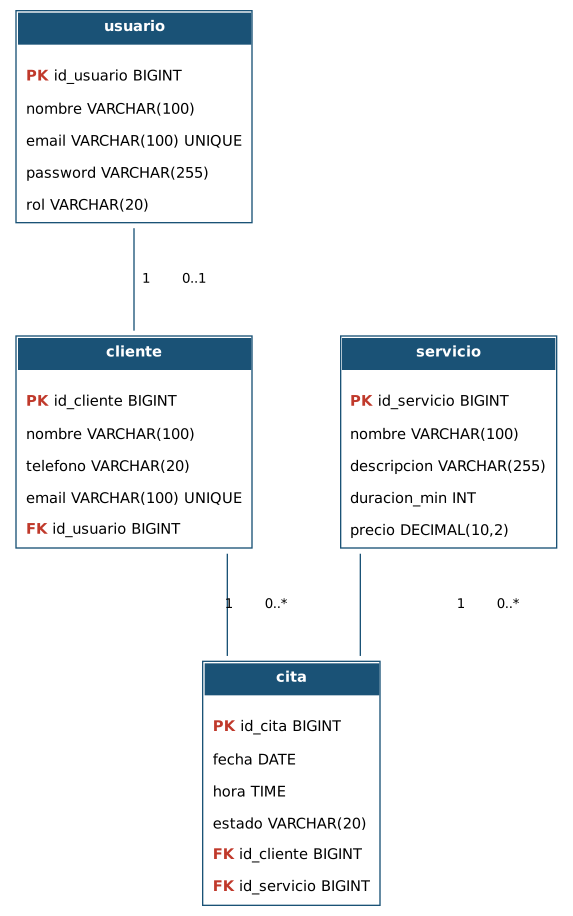

# BeautySpot — Sistema de Gestión de Citas y Servicios

Aplicación web de 3 capas para la gestión de citas de un spa / salón de
belleza. Proyecto de **Desarrollo de Aplicaciones Empresariales** —
Backend Spring Boot / Frontend JavaScript genérico.

**Autor:** Santiago Rios Manrique

---

## 1. Arquitectura (3 capas)

```
┌─────────────────────┐      HTTP / JSON      ┌──────────────────────┐      JDBC      ┌──────────────┐
│  Frontend            │  ───────────────────▶ │  Backend              │ ─────────────▶ │  Base de     │
│  HTML + CSS + JS      │ ◀───────────────────  │  Spring Boot (REST)   │ ◀───────────── │  datos       │
│  (static, sin         │                       │  Spring Security      │                │  relacional  │
│  frameworks)           │                       │  Spring Data JPA      │                │  (H2 / MySQL)│
└─────────────────────┘                       └──────────────────────┘                └──────────────┘
```

- **Presentación:** `backend/src/main/resources/static` — HTML/CSS/JS puro que
  consume la API REST con `fetch`.
- **Lógica de negocio / API:** Spring Boot (`controller` → `service` →
  `repository`), autenticación HTTP Basic + BCrypt.
- **Datos:** base de datos relacional. Por defecto corre contra **H2
  embebida** (cero instalación); el driver de **MySQL** ya está incluido
  para apuntar a un servidor real en producción (ver `application.properties`).

## 2. Cómo ejecutar el proyecto

Requisitos: JDK 17+ y Maven instalado (`mvn -version`).

```bash
cd backend
mvn spring-boot:run
```

Abrir el navegador en **http://localhost:8080**. El frontend, el backend y
la base de datos corren juntos con este único comando (la base de datos H2
se crea automáticamente como un archivo en `backend/data/`).

### Usuarios de prueba (creados automáticamente al arrancar)

| Rol      | Email                      | Password     |
|----------|-----------------------------|--------------|
| ADMIN    | admin@beautyspot.com        | admin123     |
| CLIENTE  | camila.torres@mail.com      | cliente123   |

También se puede crear una cuenta nueva de cliente desde la pantalla de
"Crear cuenta" del frontend, o vía `POST /api/auth/registro`.

### Consola de la base de datos (opcional)

Con la app corriendo: http://localhost:8080/h2-console
JDBC URL: `jdbc:h2:file:./data/beautyspot` — usuario `sa`, sin contraseña.

### Desplegar contra MySQL en lugar de H2

En `backend/src/main/resources/application.properties` comenta el bloque H2
y descomenta el bloque MySQL (usuario/contraseña/URL de tu servidor). El
script `docs/beautyspot_db_mysql.sql` crea el esquema y los datos de
ejemplo manualmente si no se quiere depender de `ddl-auto=update`.

## 3. Seguridad (autenticación)

- Las contraseñas se almacenan **cifradas con BCrypt**, nunca en texto plano.
- La autenticación usa **HTTP Basic**: el frontend guarda las credenciales
  codificadas en Base64 en `sessionStorage` tras un login válido y las
  reenvía en el header `Authorization` en cada petición.
- Autorización por rol con `@PreAuthorize`:
  - **ADMIN**: CRUD completo de usuarios, clientes, servicios y citas.
  - **CLIENTE**: puede ver el catálogo de servicios, agendar citas, ver su
    propio historial (`/api/citas/mis-citas`) y cancelar sus citas.
  - El catálogo de servicios (`GET /api/servicios`) y el registro
    (`POST /api/auth/registro`) son públicos; el resto exige autenticación.

## 4. Endpoints principales de la API REST

| Método | Endpoint                         | Acceso           | Descripción                          |
|--------|-----------------------------------|-------------------|---------------------------------------|
| POST   | `/api/auth/registro`              | Público           | Registrar un nuevo cliente            |
| GET    | `/api/auth/me`                    | Autenticado       | Datos del usuario autenticado         |
| GET    | `/api/servicios`                  | Público           | Listar servicios                      |
| POST/PUT/DELETE | `/api/servicios/{id}`    | ADMIN             | CRUD de servicios                     |
| GET    | `/api/clientes`                   | ADMIN             | Listar clientes                       |
| GET    | `/api/clientes/mi-perfil`         | CLIENTE           | Perfil del cliente autenticado        |
| POST/PUT/DELETE | `/api/clientes/{id}`     | ADMIN             | CRUD de clientes                      |
| GET    | `/api/citas`                      | ADMIN             | Listar todas las citas                |
| GET    | `/api/citas/mis-citas`            | CLIENTE           | Historial de citas propio             |
| POST   | `/api/citas`                      | Autenticado       | Agendar cita                          |
| PATCH  | `/api/citas/{id}/cancelar`        | Autenticado       | Cancelar una cita                     |
| PATCH  | `/api/citas/{id}/estado`          | ADMIN             | Cambiar estado de una cita            |
| PUT/DELETE | `/api/citas/{id}`             | ADMIN             | Editar / eliminar cita                |
| GET/POST/PUT/DELETE | `/api/usuarios/**`      | ADMIN             | CRUD de usuarios                      |

## 5. Estructura del repositorio

```
beautyspot/
├── README.md
├── backend/                          <- Proyecto Maven (Spring Boot)
│   ├── pom.xml
│   └── src/main/
│       ├── java/com/beautyspot/
│       │   ├── model/                <- Entidades JPA (Usuario, Cliente, Servicio, Cita)
│       │   ├── repository/           <- Repositorios Spring Data JPA
│       │   ├── service/               <- Lógica de negocio
│       │   ├── controller/           <- Controladores REST
│       │   ├── config/               <- Seguridad (Spring Security)
│       │   ├── dto/                   <- DTOs de entrada/salida
│       │   └── exception/            <- Manejo global de errores
│       └── resources/
│           ├── application.properties
│           └── static/               <- Frontend (HTML + CSS + JS genérico)
│               ├── index.html
│               ├── css/styles.css
│               └── js/{api.js, app.js}
└── docs/
    ├── requerimientos_funcionales.md
    ├── der.png                        <- Diagrama entidad-relación
    └── beautyspot_db_mysql.sql        <- Script de base de datos para MySQL
```

## 6. Requerimientos funcionales

Ver `docs/requerimientos_funcionales.md` para el listado completo (RF-01 a
RF-09) con su correspondencia a los endpoints que los implementan.

## 7. Diagrama entidad-relación



Entidades: **usuario** (autenticación), **cliente**, **servicio**, **cita**.
Relaciones: un usuario tiene a lo sumo un cliente asociado (1 a 0..1); un
cliente puede tener muchas citas (1 a 0..*); un servicio puede estar en
muchas citas (1 a 0..*).
